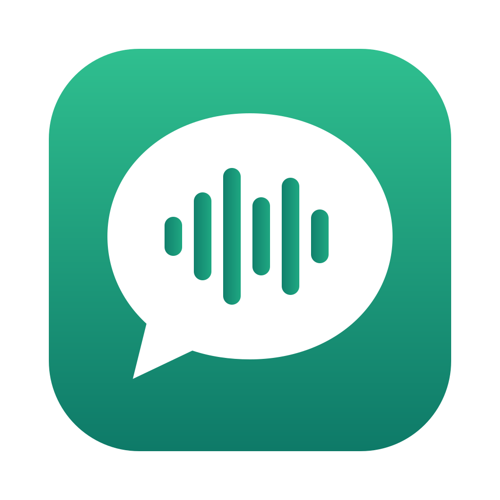

<!--
SPDX-FileCopyrightText: 2026 Leandro Garcia
SPDX-License-Identifier: MIT
-->

<p align="center"></p>

# whatsapp-local

[](https://github.com/lgarciasbr/whatsapp-local/actions/workflows/testes.yml)

Lê conversas do WhatsApp, transcreve áudios e vídeos **nesta máquina** com [whisper.cpp](https://github.com/ggml-org/whisper.cpp) e exporta para Markdown. Serve para resumir conversas, levantar demandas e acompanhar negociações, sozinho ou com um agente de IA (Claude Code, Pi, Codex), sem mandar áudio para serviço de transcrição.

- **Esta versão não envia mensagens.** Só lê: não envia, responde, reage nem marca mensagens como lidas.
- **Três fontes.** O app WhatsApp Desktop do Mac (lendo o banco local), um servidor [WAHA](https://waha.devlike.pro) que você controla, ou o espelho local do [wacli](https://wacli.sh).
- **Mais de um número.** Cada conta tem nome: `wa --conta pessoal ...`.
- **Sync.** Mantém conversas escolhidas (por nome, número ou grupo) exportadas e transcritas numa pasta, sem perder histórico.
- **Obsidian CRM.** Integração opcional com o plugin [Obsidian CRM](https://github.com/lgarciasbr/obsidian-crm).
- Só a biblioteca padrão do Python. Nenhuma dependência de pip.

## Onde roda

| | macOS | Linux | Windows |
|---|---|---|---|
| Fonte WAHA | sim | sim | não testado |
| Fonte wacli | sim | sim | não testado |
| Fonte app do Mac | sim (WhatsApp Desktop nativo) | não existe app oficial | não suportado |
| Transcrição, exportação e sync | sim | sim | não testado |
| Agendamento (`wa agendar`) | launchd + app WhatsApp Local Sync | systemd ou cron | não |

**Windows não foi testado.** A fonte WAHA usa só HTTP e pode funcionar, mas sem garantia. Ler o app de Windows não é suportado: ele guarda o banco num formato criptografado diferente.

## Instalação

Precisa do Python 3.9+, do `ffmpeg` e do `whisper-cli` (whisper.cpp).

```bash
# macOS
brew install ffmpeg whisper-cpp
# Linux: ffmpeg pelo gerenciador da distribuição; whisper.cpp compilado (instruções no instalador)

git clone https://github.com/lgarciasbr/whatsapp-local.git
cd whatsapp-local
python3 instalar.py
```

O instalador confere as dependências, cria o comando `wa` em `~/.local/bin`, pergunta quais contas configurar (app do Mac, WAHA e/ou wacli), guarda a API key do WAHA fora do config e instala a skill para os agentes encontrados.

Depois, um modelo do whisper. Se você já tiver um `ggml-*.bin`, o `wa modelo` acha. Senão:

```bash
wa baixar-modelo turbo                # mostra tamanho e destino
wa baixar-modelo turbo --confirmado   # baixa (1,6 GB) e confere o SHA-256
```

## Uso

```bash
wa contas --testar                         # contas configuradas e conexão
wa conversas --busca "maria"               # acha a conversa
wa inventario --com "Maria Silva" --dias 30
wa transcrever --com "Maria Silva" --dias 30
wa mensagens --com "Maria Silva" --dias 30
wa exportar --com "Maria Silva" --dias 30 --destino ~/Notas/WhatsApp
wa --conta pessoal conversas               # outra conta
```

`--com` aceita nome, número com DDI ou id. Se um nome bater com mais de uma conversa, o `wa` lista as opções e não escolhe sozinho.

A exportação cria uma pasta por conversa com o transcript em Markdown, `Anexos/` (prontos para o Obsidian) e `Mensagens.json`. O JSON guarda tudo o que já foi exportado: as próximas exportações juntam as mensagens novas pelo id do WhatsApp, sem apagar o histórico, mesmo que ele tenha sumido da fonte.

## Configuração

`~/.config/whatsapp-local/config.json` (veja [exemplos/config.exemplo.json](exemplos/config.exemplo.json)):

```json
{
  "dados": "~/.local/share/whatsapp-local",
  "conta_padrao": "trabalho",
  "contas": {
    "trabalho": {"fonte": "waha", "url": "https://waha.exemplo.com", "sessao": "default"},
    "mac": {"fonte": "desktop"},
    "espelho": {"fonte": "wacli", "conta_wacli": "pessoal"}
  },
  "whisper": {"idioma": "pt"}
}
```

- **`dados`**: onde ficam a mídia baixada e as transcrições (uma pasta por conta). Uma conta pode ter `"dados"` próprio; duas contas do mesmo número (app do Mac e WAHA) podem apontar para a mesma pasta.
- **API key do WAHA**: na variável `WAHA_API_KEY_<CONTA>` (ex.: `WAHA_API_KEY_TRABALHO`) ou em `segredos.env`, ao lado do config, com permissão só do usuário. Nunca no `config.json`.
- **`whisper`**: `idioma`, e opcionalmente `modelo` (caminho do `ggml-*.bin`) e `executavel` (caminho do `whisper-cli`).

### Qual fonte usar

Escolha uma por conta. As três devolvem o mesmo formato de mensagem. O id da mensagem no WhatsApp é o mesmo, então duas contas do mesmo número podem apontar para a mesma pasta de `dados`.

| Fonte | Quando | O que precisa |
|---|---|---|
| `desktop` | Mac com o WhatsApp Desktop nativo já logado | Acesso Total ao Disco no terminal |
| `waha` | Um servidor WAHA seu, no Mac, Linux ou outra máquina | URL, nome da sessão e API key |
| `wacli` | Sem servidor. O espelho fica neste computador | Binário `wacli`, pareamento e `wacli sync` |

O `wa` não pareia, não envia e não marca como lida. Na fonte wacli, quem fala com o WhatsApp é o `wacli`. `wa sync` e a leitura de uma conversa (`wa mensagens`, `wa exportar`, `wa transcrever`) rodam `wacli sync --once` antes de ler. Se essa atualização falhar, a conta fica de fora: o `wa` não exporta o arquivo velho como se estivesse em dia.

### Fonte wacli, do zero

```bash
# macOS ou Linux. No Windows, baixe o zip da release e coloque wacli.exe no PATH.
brew install openclaw/tap/wacli

wacli accounts add pessoal          # pede o pareamento (QR ou código no celular)
wacli --account pessoal sync --once # enche o espelho e sai
```

Depois, no `config.json`:

```json
"pessoal": {"fonte": "wacli", "conta_wacli": "pessoal"}
```

`conta_wacli` é o nome dado no `wacli accounts add`. O `wa` acha o config do wacli em `~/.wacli/config.yaml` ou, no Linux, em `~/.local/state/wacli/config.yaml`. Se o espelho estiver em outro lugar, use `"store": "~/caminho/do/espelho"`. O `wa` lê `wacli.db` e, se existir, só a tabela `whatsmeow_lid_map` de `session.db` (lid e telefone, para usar o mesmo id das outras fontes). Não lê chaves.

O pareamento é manual (`wacli accounts add`). Depois disso, o `wa` atualiza o espelho sozinho na hora de ler ou sincronizar. Não precisa deixar o `wacli sync --follow` ligado.

Mídia que ainda não está no disco é pedida com `wacli --read-only media download`. Isso não grava no espelho e não marca a conversa como lida. Áudio antigo pode ter saído do servidor. O `wa` não pede reenvio pelo celular.

O pareamento ocupa uma vaga de aparelho conectado. O WhatsApp Web não é API oficial. O histórico que chega é o que o celular manda, sem garantia de estar completo.

## Sync

```json
"sync": {
  "dias": 30,
  "destino": "~/Notas/WhatsApp",
  "conversas": [
    {"conversa": "Maria Silva"},
    {"conversa": "+5511999999999", "conta": "pessoal"},
    {"conversa": "Equipe Projeto X", "destino": "~/Notas/Projeto X"}
  ]
}
```

`wa sync` primeiro atualiza o espelho das contas wacli. Nas outras fontes a leitura já vai ao WhatsApp (WAHA) ou ao banco do app (Mac). Depois baixa a mídia que falta (WAHA, ou wacli em modo somente leitura; no app do Mac, só se `baixar_midia_desktop` estiver ligado), transcreve e exporta cada conversa. Na primeira vez entra o que a fonte tem; o que já foi exportado continua no `Mensagens.json`. Nas seguintes, entram os últimos `dias`. Na primeira vez, o nome é resolvido e o id da conversa fica gravado em `<dados>/sync-estado.json`; depois, o sync segue pelo id mesmo que o nome mude. Uma conversa com problema não para as outras.

### Sync incremental

Depois de uma leitura bem-sucedida, o sync compara a data da última mensagem no resumo da conversa. Sem mudança, adia a leitura e não regrava os transcripts. Esse resumo pode ficar desatualizado no WAHA: por isso, relê ao menos uma vez a cada 24 horas **quando o sync é executado**. Para conferir imediatamente: `wa sync --forcar`.

Mensagens na mesma marca de tempo, edições e mudanças que não alteram o resumo podem esperar essa releitura. O histórico exportado continua preservado, inclusive mensagens removidas da fonte. Falhas de exportação ou transcrição não habilitam o atalho. Mesmo numa releitura, arquivos com conteúdo idêntico não são regravados.

### Coleta separada (só o banco do wacli)

```bash
wa coletar                       # todas as contas com fonte wacli, sem precisar configurar sync ou CRM
wa --conta pessoal coletar       # só uma conta
```

Busca mensagens para o banco local e encerra. Não baixa mídia, não transcreve, não exporta e não altera o CRM. WAHA e Desktop não são coletados por esse comando. Cada conta tem limite de 240 segundos; uma falha não impede a tentativa nas outras, mas o comando termina com código 1 se alguma falhar. Coleta e `wa sync` compartilham a mesma trava: uma execução não atropela a outra. Um wacli externo também pode ocupar a conta; nesse caso a coleta informa o conflito, sem parar o outro processo. `wa sync` continua atualizando o banco antes de exportar.

Pode agendar `wa coletar` no cron, launchd ou outro agendador, separadamente do sync completo. `wa agendar` continua agendando o sync completo.

#### Automação local no Orca

Automação **Coleta WhatsApp Local**, ID `adfcadc1-31b4-433b-b8e1-bacdfc2a7a63`, a cada 30 minutos (`*/30 * * * *`, America/Sao_Paulo), no projeto whatsapp-local. A coleta roda no precheck, com `/bin/sh scripts/coletar-orca.sh`. Sucesso aparece como `skipped_precheck` e não abre agente; falha abre o Pi só para relatar o log, sem repetir coleta. “Run now” pula o precheck, portanto só mostra o log.

O script usa a configuração do usuário, sem contas ou segredos embutidos. Log privado: `${XDG_STATE_HOME:-~/.local/state}/whatsapp-local/coleta.log`. O limite do precheck é 600 segundos (suficiente para as duas contas atuais); instalações com mais contas precisam dividir a coleta por conta ou usar outro agendador. Só roda com o Orca aberto e a máquina acordada. Para testar a coleta manualmente: `/bin/sh scripts/coletar-orca.sh`. Não depende do projeto de resumos de grupos.

### Agendamento

`wa agendar` mostra o agendamento; `wa agendar --instalar` instala, a cada 30 minutos por padrão (`--minutos N`); `wa agendar --remover` desfaz. Se a seção `"sync"` não tiver nenhuma conversa nem a integração com o CRM, o sync avisa que não há nada configurado.

- **Linux:** timer do systemd de usuário ou, sem ele, uma linha de cron.
- **macOS:** o launchd abre o app **WhatsApp Local Sync** (`~/Applications`), que só executa `wa sync`. O macOS protege Documentos, iCloud Drive e pastas como a do OneDrive; um Python iniciado direto pelo launchd não tem a quem pedir permissão e é bloqueado. Na primeira execução, o macOS pede a permissão em nome do app: permita. Ela vale só para esse app, não para o Python nem para o terminal. O app é criado com `osacompile` e assinado localmente, sem nenhuma dependência. Reinstalar o agendamento só recria o app quando algo mudou (o comando, o ambiente ou o ícone); se ele for recriado, o macOS pede a permissão de novo. Logs em `<dados>/logs/` (`sync.log` e `erros.log`).

## Integração com o Obsidian CRM

O instalador principal cuida apenas do WhatsApp. Esta integração é opcional e não é necessária para ler, transcrever ou sincronizar conversas.

Se você também usa o plugin [Obsidian CRM](https://github.com/lgarciasbr/obsidian-crm), execute **depois da instalação**, na pasta do whatsapp-local:

```bash
python3 integrar_obsidian_crm.py
```

Esse configurador separado pede o vault e as contas onde procurar. Ele habilita o sync de **todas as pessoas do CRM encontradas pelo telefone**, sem manter uma lista manual. Faz backup da configuração antes de alterá-la, preserva as contas, os grupos e as associações existentes, e não mexe em segredos, no plugin ou no `AGENTS.md` do CRM. Não instala o plugin: instale-o pelo repositório acima antes de integrar.

Não precisa de outra skill: a skill `whatsapp-local`, registrada no Pi (ou no agente escolhido) pelo instalador principal, já sabe executar `wa sync`. A integração só fornece a configuração local.

Você também pode configurar manualmente:

```json
"sync": {
  "obsidian_crm": {
    "vault": "~/Obsidian/Meu Vault",
    "contas": ["trabalho", "pessoal"],
    "pessoas": {"Maria Silva": "5511999999999@c.us"},
    "grupos": [{"conversa": "Equipe Projeto X", "nome": "Projeto X"}]
  }
}
```

Para cada pessoa do CRM (nota `type: crm/person`), o sync procura a conversa pelo `phone` em cada conta de `contas` e exporta para `<pasta do CRM>/WhatsApp/People/`. Os grupos listados vão para `Group/<nome>/`. A pasta do CRM vem das configurações do plugin. O resultado fica em `<pasta do CRM>/WhatsApp/Status da sincronização.md`.

- **Uma pasta por conversa.** Na primeira conta de `contas`, a pasta é `<nome>`; nas outras, `<nome> (<conta>)`. Se a mesma conta tiver outra conversa da pessoa (um número antigo, por exemplo), a extra leva o número: `<nome> (+55 11 91234-5678)`.
- **Telefone.** Sem `+` e com 10 ou 11 dígitos, vale o país padrão (`ddi_padrao`, 55). Com `+`, o país já está explícito. Celulares brasileiros com e sem o nono dígito são o mesmo número.
- Numa conta, a pessoa só é associada quando o telefone leva a uma única conversa. Nunca por nome. Quem não tem telefone no CRM fica pendente, a menos que esteja em `pessoas`.
- Na primeira exportação de cada conversa vem o histórico inteiro; depois, só os últimos `dias`.
- As notas do CRM só são lidas; o sync escreve apenas dentro de `WhatsApp/`.

## O que saber

- **Histórico.** O app do Mac e o WAHA são aparelhos vinculados: só têm o que o WhatsApp sincronizou quando foram conectados, mais o que chegou depois. O que já foi exportado continua no `Mensagens.json`.
- **Mídia expira.** Áudio e vídeo saem do servidor do WhatsApp em umas 2 semanas. Depois disso, só reenviando. Por isso vale rodar o sync com frequência.
- **Fonte desktop.** O terminal precisa de Acesso Total ao Disco para ler o banco do app; no agendamento, quem precisa é o app WhatsApp Local Sync. Baixar mídia que o app não baixou consulta o servidor do WhatsApp por fora do app oficial; o `wa` só faz isso quando pedido.
- **Fonte WAHA.** O áudio passa pelo seu servidor WAHA antes de chegar aqui; a transcrição continua local. Testado com o engine WEBJS. Ler uma conversa inteira pode levar uns 30 s; o sync lê só a janela recente.
- **Fonte wacli.** O espelho e as chaves do aparelho vinculado ficam em `~/.wacli` (ou no `store` configurado), fora deste repositório, com permissão só do usuário. O `wa` não envia mensagem por esse binário.
- **Privacidade.** São conversas privadas. Mídia, transcrições e exportações ficam nas pastas que você escolher, com permissão só do seu usuário. Configuração pessoal e API key ficam em `~/.config/whatsapp-local/` (`config.json` e `segredos.env`, modo 600), também fora do repositório. Não copie isso, nem `~/.wacli`, nem uma pasta exportada, para um Git.

## Testes

```bash
python3 -m unittest discover -s tests -t .
```

Os testes usam um WAHA falso, um banco do app do Mac falso e um vault de CRM falso. Nenhum dado real. Rodam a cada mudança no macOS e no Linux, com Python 3.9, 3.12 e 3.13.

## Créditos

- **Filipe, da Comunidade Ratos de IA**: primeira versão (`whatsapp-desktop-local`): leitura do WhatsApp Desktop do Mac, decifragem da mídia, transcrição local com whisper.cpp e a skill.
- **Leandro Garcia**: fonte WAHA, contas, sync, exportação, integração com o Obsidian CRM, instalador e testes, e as alterações nos arquivos da primeira versão.

O logo ([`assets/logo.svg`](assets/logo.svg)) é de Leandro Garcia, sob a mesma licença MIT, e também é o ícone do app do macOS (`macos/icone.icns`, gerado por `macos/gerar_icone.sh`).

Cada arquivo diz no cabeçalho de quem é (padrão [REUSE](https://reuse.software)/SPDX). Histórico em [CHANGELOG.md](CHANGELOG.md).

## Licença

[MIT](LICENSE). Copyright (c) 2026 Filipe (Comunidade Ratos de IA) e Leandro Garcia.
